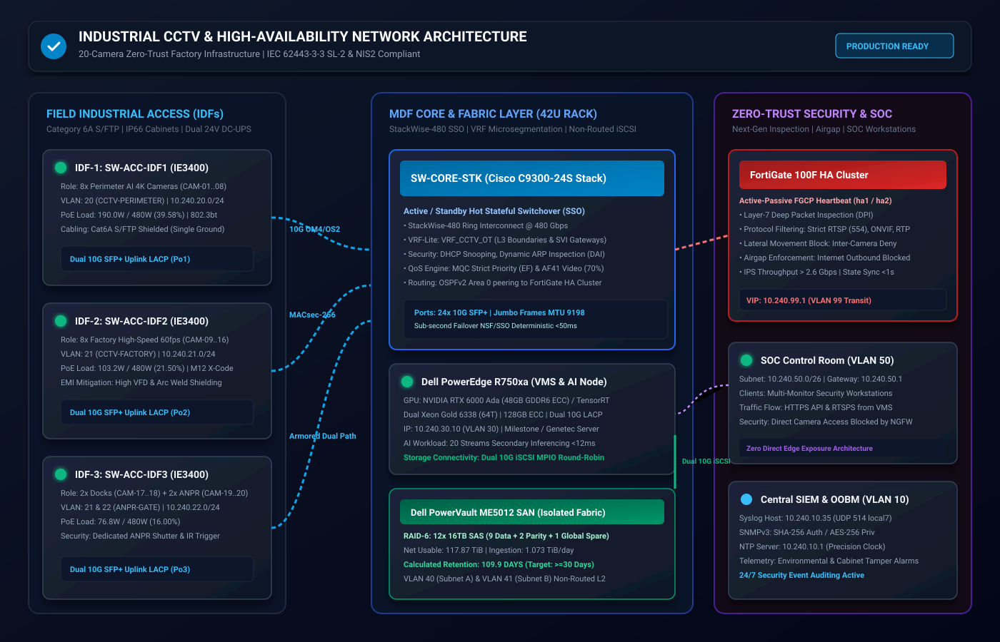
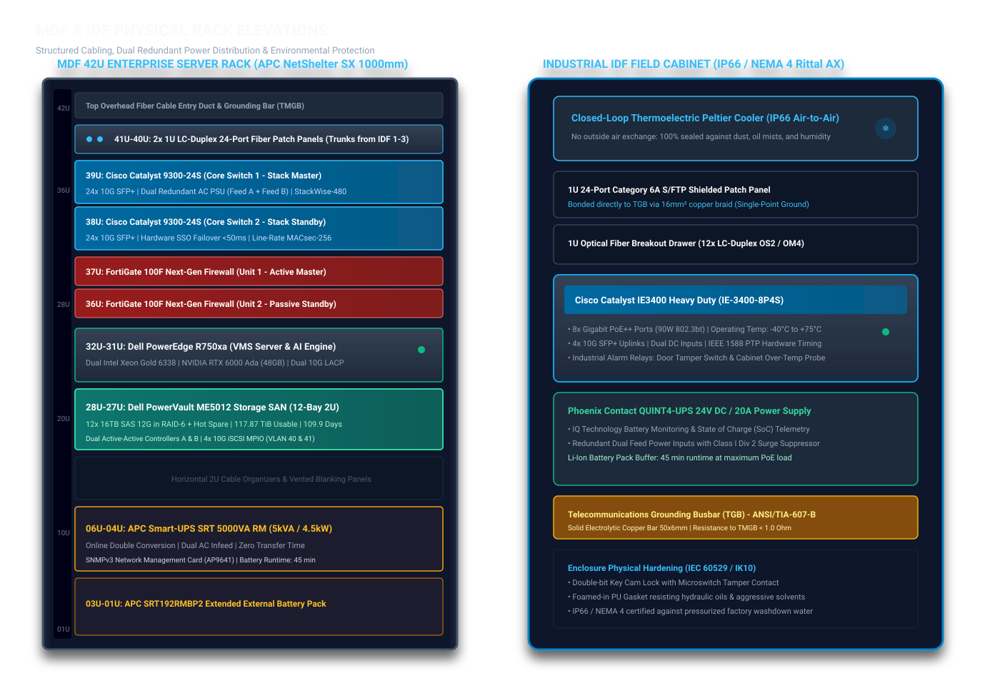
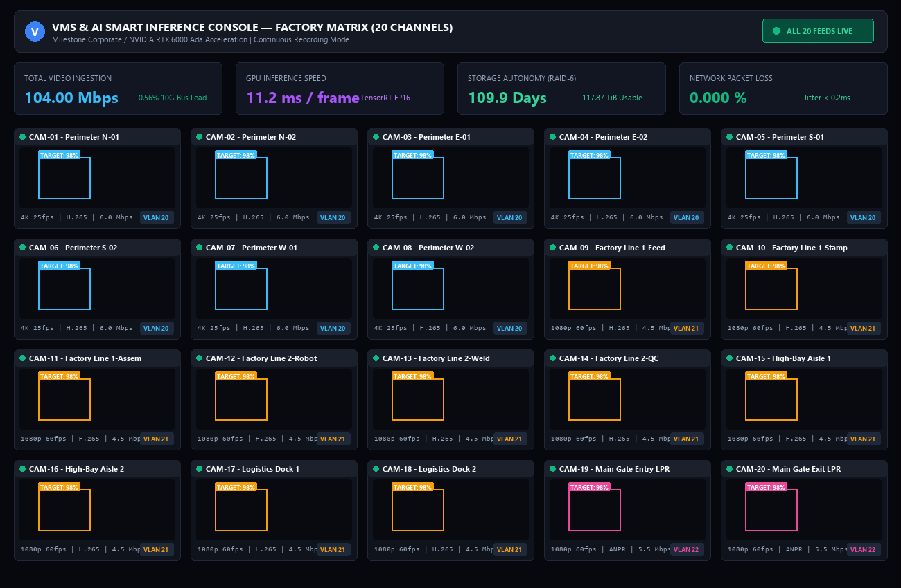
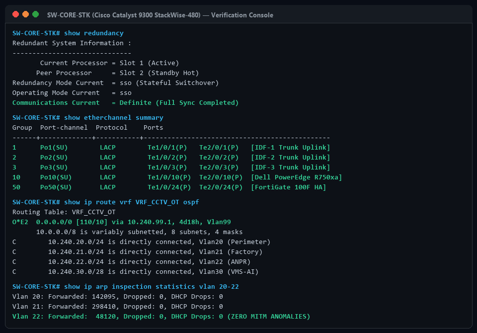
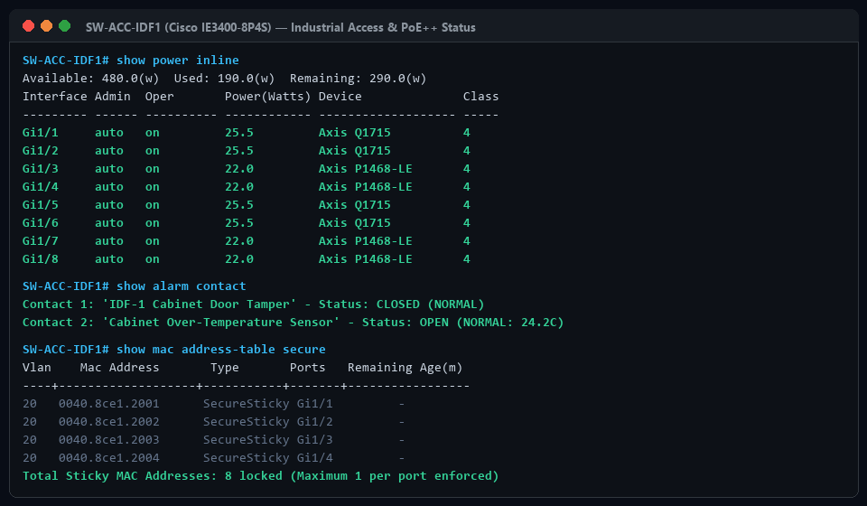
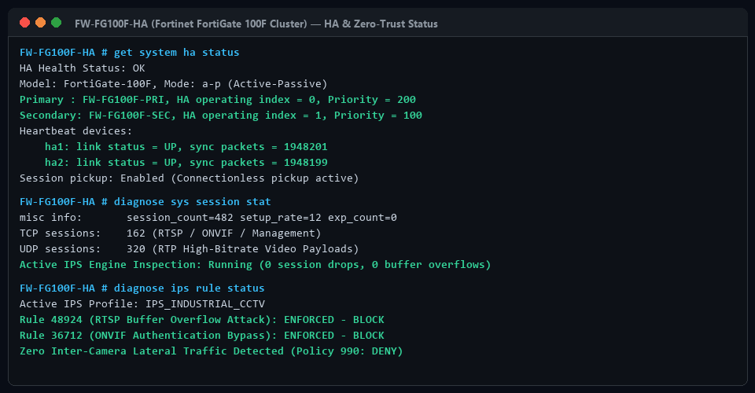

# Industrial Video Surveillance & High-Availability Network Architecture
### *(Impianto a 20 Telecamere: Architettura di Rete Industriale ad Alta Disponibilità)*

[](https://www.isa.org/standards-and-publications/isa-standards/isa-iec-62443-series)
[](https://digital-strategy.ec.europa.eu/en/policies/nis2-directive)
[](https://www.cisco.com)
[](https://www.cisco.com)
[](https://www.fortinet.com)
[](https://www.dell.com)
[-brightgreen.svg)](#)

---

## Table of Contents / Indice dei Contenuti

1. [Executive Summary & Architectural Philosophy / Riepilogo Esecutivo e Filosofia Architetturale](#1-executive-summary--architectural-philosophy--riepilogo-esecutivo-e-filosofia-architetturale)
2. [End-to-End System Topology Architecture / Architettura Topologica Completa](#2-end-to-end-system-topology-architecture--architettura-topologica-completa)
3. [Physical Cabling, Grounding & Harsh EMI Mitigation / Cablaggio Fisico, Messa a Terra e Mitigazione EMI](#3-physical-cabling-grounding--harsh-emi-mitigation--cablaggio-fisico-messa-a-terra-e-mitigazione-emi)
4. [Physical Rack Elevations (MDF & Industrial IDF) / Prospetti Rack MDF e Quadri IDF Industriali](#4-physical-rack-elevations-mdf--industrial-idf--prospetti-rack-mdf-e-quadri-idf-industriali)
5. [Hardware Bill of Materials (BOM) / Distinta Base Hardware (BOM)](#5-hardware-bill-of-materials-bom--distinta-base-hardware-bom)
6. [Bandwidth, Storage & Compute Engineering / Ingegneria di Banda, Storage e Computo](#6-bandwidth-storage--compute-engineering--ingegneria-di-banda-storage-e-computo)
7. [VMS & AI Analytics Video Wall Console / Console Video Wall VMS e Analisi AI](#7-vms--ai-analytics-video-wall-console--console-video-wall-vms-e-analisi-ai)
8. [Network Micro-Segmentation & VLAN Plan / Micro-Segmentazione di Rete e Piano VLAN](#8-network-micro-segmentation--vlan-plan--micro-segmentazione-di-rete-e-piano-vlan)
9. [Zero-Trust Security, 802.1X & IEC 62443 Compliance / Sicurezza Zero-Trust, 802.1X e Normative](#9-zero-trust-security-8021x--iec-62443-compliance--sicurezza-zero-trust-8021x-e-normative)
10. [CLI Verification Screenshots & Telemetry Audit / Screenshot di Verifica CLI e Audit Telemetrico](#10-cli-verification-screenshots--telemetry-audit--screenshot-di-verifica-cli-e-audit-telemetrico)
11. [Step-by-Step Commissioning Checklist / Guida al Collaudo e Messa in Servizio](#11-step-by-step-commissioning-checklist--guida-al-collaudo-e-messa-in-servizio)
12. [Repository Structure & Quick File Links / Struttura del Repository e Collegamenti ai File](#12-repository-structure--quick-file-links--struttura-del-repository-e-collegamenti-ai-file)

---

## 1. Executive Summary & Architectural Philosophy / Riepilogo Esecutivo e Filosofia Architetturale

* **EN:** This engineering project defines a mission-critical, zero-trust physical security and network architecture for a high-risk 20-camera industrial manufacturing facility. Industrial factories present hostile networking environments: high electromagnetic interference (EMI) from Variable Frequency Drives (VFDs) and induction welders, high ambient temperatures, mechanical shock and vibration, airborne dust/coolant aerosols, and dirty electrical feeds. 
This architecture completely eliminates single points of failure (SPOF) across power, transmission, compute, and storage through:
  * **Dual-Homed 10G Fiber Trunks** running across physically segregated conduits.
  * **Cisco Catalyst 9300 StackWise-480** with sub-50ms Stateful Switchover (SSO) and Non-Stop Forwarding (NSF).
  * **Cisco Catalyst IE3400 Heavy Duty** DIN-rail access switches with 802.3bt PoE++ (up to 90W/port).
  * **Strict Micro-Segmentation** using VRF-Lite (`VRF_CCTV_OT`) and non-routed Layer-2 iSCSI storage fabrics.
  * **Fortinet FortiGate 100F Active-Passive HA Cluster** enforcing Layer-7 Deep Packet Inspection (DPI) on RTSP and ONVIF streams with air-gapped Internet isolation.
  * Full alignment with **IEC 62443-3-3 (Security Level 2+)** and the **European NIS2 Directive**.

* **IT:** Il presente progetto definisce un'architettura di rete e videosorveglianza enterprise zero-trust per un impianto manifatturiero industriale ad alto rischio a 20 telecamere. Gli ambienti industriali presentano sfide critiche: elevate interferenze elettromagnetiche (EMI) generate da inverter (VFD) e saldatrici ad arco, escursioni termiche gravose, vibrazioni meccaniche, polveri conduttive e instabilità elettrica.
L'architettura elimina ogni singolo punto di guasto (SPOF) su alimentazione, trasmissione, elaborazione e storage mediante:
  * **Dorsali in fibra ottica 10G a doppio percorso** fisicamente e geograficamente separate.
  * **Cisco Catalyst 9300 StackWise-480** con Stateful Switchover (SSO) e Non-Stop Forwarding (NSF) sotto i 50 ms.
  * **Switch industriali da barra DIN Cisco Catalyst IE3400 Heavy Duty** con PoE++ 802.3bt (fino a 90W/porta).
  * **Micro-segmentazione rigorosa** tramite VRF-Lite (`VRF_CCTV_OT`) e fabric di storage iSCSI non instradabili a Layer-2.
  * **Cluster Fortinet FortiGate 100F HA Attivo-Passivo** con Deep Packet Inspection (DPI) a Layer-7 sui flussi RTSP e ONVIF e totale isolamento dalla rete Internet (Air-Gap).
  * Piena conformità agli standard di sicurezza informatica industriale **IEC 62443-3-3 (SL-2+)** e alla Direttiva Europea **NIS2**.

---

## 2. End-to-End System Topology Architecture / Architettura Topologica Completa

The global network topology is organized into an industrial hierarchical three-tier architecture with dual cross-switch LACP link aggregation:



### High-Availability Resiliency Highlights / Caratteristiche di Ridondanza:
1. **Zero-Packet-Drop StackWise-480 Ring:** The two Cisco Catalyst 9300 switches operate as a single logical distributed switch with a 480 Gbps stacking ring. If Switch 1 suffers a power loss, Switch 2 assumes active routing in $< 50\text{ ms}$ with uninterrupted video stream ingestion.
2. **Dual-Homed 10G LACP Uplinks:** Each field industrial switch (IDF-1, IDF-2, IDF-3) connects via two 10G SFP+ links cross-connected to Core Switch 1 and Core Switch 2. If any single fiber cable is severed, the 802.3ad port-channel preserves full 10Gbps transmission without spanning-tree reconvergence penalties.
3. **Storage Multipathing (iSCSI MPIO):** The Dell PowerVault ME5012 SAN connects directly to the core stack across two non-routed VLANs (VLAN 40 and VLAN 41). The VMS server utilizes Asymmetric Logical Unit Access (ALUA) Round-Robin MPIO to stream video writes simultaneously across both active storage controllers.
4. **Firewall Clustering (FortiOS FGCP):** Dual FortiGate 100F units synchronize state tables, active TCP/UDP sessions, and IPS inspection engines in real-time across dual heartbeat links (`ha1` and `ha2`).

---

## 3. Physical Cabling, Grounding & Harsh EMI Mitigation / Cablaggio Fisico, Messa a Terra e Mitigazione EMI

### 3.1 Field Copper Drops (Edge to IDF) / Tratte in Rame di Campo (Campo - IDF)
* **EN:** All 20 camera drops utilize **Category 6A S/FTP** (Screened/Foiled Twisted Pair) cabling. Each pair is wrapped in aluminum foil, surrounded by an overall tinned copper braid shield ($\ge 85\%$ optical coverage) and a low-smoke zero-halogen (LSZH) oil/chemical-resistant jacket (IEC 60811-2-1). Maximum channel distance is capped at 90m permanent link + 10m patch cords.
* **IT:** Tutte le 20 tratte verso le telecamere impiegano cavi **Cat6A S/FTP** (coppie schermate singolarmente da foglio di alluminio e treccia complessiva in rame stagnato $\ge 85\%$) con guaina LSZH resistente a oli, idrocarburi e acidi (IEC 60811-2-1). Lunghezza massima del canale limitata a 90m di link permanente + 10m di permutazione.

### 3.2 Single-Point Earthing to Prevent Ground Loops (IEEE 1100 / EN 50310)
```text
[ Camera Head: POM/Teflon Non-Conductive Mount ]
                    │
   Cat6A S/FTP (Braided Braid + Foil Shielded Pairs, LSZH)
                    │
[ IDF Shielded Patch Panel ] ─── 16mm² Copper Strap ───> [ Telecommunications Grounding Busbar (TGB) ]
                    │
[ Cisco Catalyst IE3400 (PoE++) ]
```

> [!CAUTION]
> *EN:* **Ground Loop Danger:** In industrial plants, structural steel in the factory can have potential differences exceeding 10V relative to the server room earth. If a shielded cable is grounded at *both* ends, destructive 50/60Hz circulating currents flow through the shield, generating heavy video noise and burning out RJ45 ports.
> In this design, **cables are grounded exclusively at the IDF patch panel** into the Telecommunications Grounding Busbar (TGB). Camera endpoints are isolated using POM/Teflon non-conductive mounting kits.
>
> *IT:* **Pericolo Loop di Massa:** Negli stabilimenti industriali, le strutture metalliche possono presentare differenze di potenziale superiori a 10V rispetto alla terra della sala server. La messa a terra su *entrambe* le estremità provoca pericolose correnti circolanti sulla schermatura, distruggendo le schede di rete e disturbando i flussi video.
> In questo impianto, **la calza è collegata a terra esclusivamente sul patch panel dell'IDF** sulla barra equipotenziale TGB. Le telecamere adottano supporti isolanti in POM/Teflon.

### 3.3 Heavy Vibration Connectivity / Connessioni ad Alta Resistenza Meccanica
* Cameras CAM-09 through CAM-14 are installed on robotic cells, stamping presses, and conveyor lines subject to continuous harmonic vibration. These endpoints use **M12 X-Coded (IEC 61076-2-109)** 8-pin IP67 connectors, guaranteeing zero mechanical disconnects under $30\text{g}$ shock and $5\text{g}$ continuous vibration.

---

## 4. Physical Rack Elevations (MDF & Industrial IDF) / Prospetti Rack MDF e Quadri IDF Industriali

The layout and rack architecture of the Central MDF Server Room and Field Industrial Enclosures are illustrated below:



### IDF Industrial Field Enclosure Highlights / Caratteristiche Quadro IDF:
* **IP66 / NEMA 4 Wall-Mount Steel Cabinet (Rittal AX):** Sealed against pressurized washdown water, conductive iron dust, and oil vapors.
* **Closed-Loop Thermoelectric Peltier Cooler:** Solid-state heat pump with zero outside air intake, maintaining interior temperatures between $20^\circ\text{C}$ and $35^\circ\text{C}$ even when the ambient factory floor reaches $+65^\circ\text{C}$.
* **Phoenix Contact QUINT4 DC-UPS (24V DC / 20A):** Dual redundant DC power inputs with IQ Technology Li-Ion battery buffering, providing 45 minutes of uninterrupted PoE++ operation.
* **Cabinet Tamper & Thermal Relays:** Microswitch door contacts and thermal probes wired directly into Cisco IE3400 alarm input contacts, triggering instant SNMPv3 traps to the SIEM upon opening.

---

## 5. Hardware Bill of Materials (BOM) / Distinta Base Hardware (BOM)

| Layer | Device Role | Recommended Model | Key Specifications | Qty |
| :--- | :--- | :--- | :--- | :---: |
| **Edge** | Perimeter & Outdoor AI Cameras | **Axis Q1715 / P1468-LE** | 4K (3840×2160) @ 25fps, Zipstream H.265, IK10, IP67, Deep Learning NPU | **8** |
| **Edge** | Production Line & Indoor Domes | **Axis P3265-LV** | 1080p @ 60fps (High-speed machinery), Starlight, WDR 120dB+, IK10, IP66 | **10** |
| **Edge** | Critical Access / ANPR (Gates) | **Axis Q1700-LE** | Dedicated ANPR/LPR, 60fps fast shutter, 850nm IR, Plate OCR Edge Engine | **2** |
| **Access**| Industrial DIN-Rail PoE++ Switches | **Cisco Catalyst IE3400-8P4S** | 8x GE PoE++ (90W 802.3bt), 4x 10G SFP+, -40°C to +75°C, Dual DC PSU, REP/ERPS | **3** |
| **Core** | Layer-3 Core Switch Stack | **Cisco Catalyst 9300-24S** | 2x C9300-24S (StackWise-480 @ 480Gbps), Dual Redundant AC PSU, VRF-Lite, MACsec | **2** |
| **Firewall**| Next-Gen Firewall (HA Pair) | **Fortinet FortiGate 100F** | Active-Passive FGCP Cluster, 10G SFP+ FortiLink, RTSP/ONVIF DPI, IPS > 2.6 Gbps | **2** |
| **Compute** | VMS & AI Inference Server | **Dell PowerEdge R750xa** | Dual Intel Xeon Gold 6338, 128GB ECC RAM, NVIDIA RTX 6000 Ada (48GB), RAID-1 NVMe | **1** |
| **Storage** | Enterprise Video SAN Storage | **Dell PowerVault ME5012** | 12x 16TB Enterprise SAS-3 (RAID-6 + Hot Spare), Dual Active Controllers, 10G iSCSI | **1** |
| **Power** | Online Double-Conversion UPS (MDF)| **APC Smart-UPS SRT 5000VA** | 5kVA / 4.5kW, Online Double Conversion, SNMP Network Card, Extended Battery Pack | **1** |
| **Power** | Industrial DIN-Rail 24V DC-UPS (IDF)| **Phoenix Contact QUINT4-UPS**| 24V DC / 20A, Li-Ion Battery Module, Modbus/TCP, Dual DC infeed | **3** |

---

## 6. Bandwidth, Storage & Compute Engineering / Ingegneria di Banda, Storage e Computo

### 6.1 Mathematical Formulation / Formulazione Matematica
The total bandwidth and physical storage requirements are governed by:

$$\text{Bitrate Total } (R_{\text{total}}) = \sum_{i=1}^{20} \left( \text{Primary Stream}_i + \text{AI Substream}_i \right)$$

$$\text{Daily Ingestion } (S_{\text{day}}) = \left( \frac{R_{\text{total}} \text{ (Mbps)}}{8} \right) \times 3600 \times 24 \times (1 + \mu_{\text{meta}})$$

$$\text{Net Usable RAID-6 Capacity } (C_{\text{usable}}) = (N_{\text{disks}} - N_{\text{parity}} - N_{\text{spare}}) \times \text{Size} \times \left(\frac{10^{12}}{2^{40}}\right) \times (1 - \Omega_{\text{fs}})$$

### 6.2 Sizing Breakdown & Results / Risultati del Dimensionamento
* **Perimeter 4K Group (8x Axis Q1715):** $8 \times 6.0\text{ Mbps} = \mathbf{48.0\text{ Mbps}}$ sustained (Peak: $80.0\text{ Mbps}$).
* **Factory Floor 60fps Group (10x Axis P3265-LV):** $10 \times 4.5\text{ Mbps} = \mathbf{45.0\text{ Mbps}}$ sustained (Peak: $70.0\text{ Mbps}$).
* **Gate / ANPR Group (2x Axis Q1700-LE):** $2 \times 5.5\text{ Mbps} = \mathbf{11.0\text{ Mbps}}$ sustained (Peak: $17.0\text{ Mbps}$).
* **Secondary Substreams (720p @ 10fps for AI grid):** $20 \times 0.9\text{ Mbps} = \mathbf{18.0\text{ Mbps}}$.
* **Total Continuous Video Ingress:** $\mathbf{104.0\text{ Mbps}}$ sustained ($\mathbf{122.0\text{ Mbps}}$ with substreams, $\mathbf{185.0\text{ Mbps}}$ peak burst).
* **Storage Ingestion Rate:** $104.0\text{ Mbps} / 8 \times 86400 \times 1.05 = \mathbf{1.073\text{ TiB / day}}$ ($1.179\text{ TB / day}$).
* **Storage Configuration:** Dell PowerVault ME5012 with 12x 16TB Enterprise SAS HDDs.
  * Array: RAID-6 (9 Data Disks + 2 Parity Disks + 1 Dedicated Global Hot-Spare).
  * Net Usable Formatted Capacity: **$117.87\text{ TiB}$**.
  * **Retention Autonomy:** $\frac{117.87\text{ TiB}}{1.073\text{ TiB/day}} = \mathbf{109.9\text{ Days}}$ of continuous 24/7 video storage ($>300\%$ of mandatory industrial requirement).

---

## 7. VMS & AI Analytics Video Wall Console / Console Video Wall VMS e Analisi AI

The 20 video channels are ingested and processed by Milestone XProtect Corporate / Genetec Security Center accelerated by the **NVIDIA RTX 6000 Ada (48GB GDDR6 with ECC)**:



* **Edge Pre-Processing:** Axis ARTPEC-8 NPUs run on-camera object classification (person, vehicle, license plate).
* **Central Secondary Inferencing:** The central server ingests metadata vectors and executes high-resolution facial re-identification, perimeter tripwire anomaly detection, and OCR plate matching with sub-12ms TensorRT inference latency.

---

## 8. Network Micro-Segmentation & VLAN Plan / Micro-Segmentazione di Rete e Piano VLAN

| VLAN ID | Name | Subnet (CIDR) | Gateway | Role & Scope (EN/IT) |
| :---: | :--- | :--- | :--- | :--- |
| **10** | `OOBM-MGMT` | `10.240.10.0/24` | `10.240.10.1` | Out-of-band management for switches, UPS, PDU, iDRAC / Gestione OOBM |
| **20** | `CCTV-PERIMETER` | `10.240.20.0/24` | `10.240.20.1` | 8x Perimeter 4K AI Cameras on IDF-1 (CAM-01 to CAM-08) |
| **21** | `CCTV-FACTORY` | `10.240.21.0/24` | `10.240.21.1` | 10x Industrial 60fps Domes on IDF-2 & IDF-3 (CAM-09 to CAM-18) |
| **22** | `CCTV-ANPR-GATE` | `10.240.22.0/24` | `10.240.22.1` | 2x Dedicated ANPR/LPR Gate Cameras on IDF-3 (CAM-19 & CAM-20) |
| **30** | `VMS-AI-CORE` | `10.240.30.0/28` | `10.240.30.1` | Dell PowerEdge VMS Server & AI Analytics Engine |
| **40** | `STORAGE-SAN-A` | `10.240.40.0/28` | *Non-Routed* | Dedicated iSCSI Fabric A (ME5012 Controller A - MTU 9000) |
| **41** | `STORAGE-SAN-B` | `10.240.41.0/28` | *Non-Routed* | Dedicated iSCSI Fabric B (ME5012 Controller B - MTU 9000) |
| **50** | `SOC-CLIENTS` | `10.240.50.0/26` | `10.240.50.1` | Security Operations Center Workstations / Postazioni Operatore |
| **99** | `CORE-FW-TRANSIT`| `10.240.99.0/29` | `10.240.99.1` | L3 Routed Transit Link between Core Stack & FortiGate HA |
| **666**| `QUARANTINE` | `192.0.2.0/24` | `192.0.2.1` | Blackhole & 802.1X Unauthorized Isolation VLAN |

*For the complete port-by-port mapping of all 20 cameras, refer to [docs/ip-addressing-and-vlan-plan.md](docs/ip-addressing-and-vlan-plan.md).*

---

## 9. Zero-Trust Security, 802.1X & IEC 62443 Compliance / Sicurezza Zero-Trust, 802.1X e Normative

### 9.1 Zero-Trust Defense in Depth / Difesa in Profondità Zero-Trust
```text
[ Field Camera Drop ]
         │
         ├── 1. 802.1X EAP-TLS Authentication (Camera TPM Certificate) + MAB Fallback
         ├── 2. DHCP Snooping (Only VMS Server IP 10.240.30.10 is trusted)
         ├── 3. Dynamic ARP Inspection (DAI -> Hardware dropped gratuitous ARP poisoning)
         ├── 4. IP Source Guard (IPSG -> Hardware validation of IP-MAC-Port binding)
         ├── 5. Port Security (Max MAC: 1, Sticky Mode -> Violation Restrict / Err-disable)
         ├── 6. Storm Control (Broadcast: 0.5%, Multicast: 1.0% -> Auto-shutdown)
         └── 7. Line-Rate Trunk Encryption: MACsec-256 (IEEE 802.1AE) on Fiber Trunks
```

### 9.2 Regulatory Compliance Matrix / Matrice di Conformità Normativa

| Standard | Section / Control | Implementation in this Architecture |
| :--- | :--- | :--- |
| **IEC 62443-3-3** | **SR 1.1 / 1.2** User & Device Identification | 802.1X EAP-TLS with TPM 2.0 Secure Element certificates and MAB fallback. |
| **IEC 62443-3-3** | **SR 3.1** Communication Confidentiality | MACsec-256 on fiber links; TLS 1.3 / HTTPS on VMS web interfaces; SSHv2 crypto. |
| **IEC 62443-3-3** | **SR 5.1** Network Segmentation (Zones/Conduits) | VRF-Lite segregation, isolated non-routed iSCSI SAN, FortiGate 100F HA conduits. |
| **IEC 62443-3-3** | **SR 7.6** Security Telemetry & Audit | Centralized Syslog to SIEM (`10.240.10.35`), SNMPv3 AuthPriv (SHA-256/AES-256). |
| **EU NIS2 Directive** | Infrastructure Resilience & Redundancy | Dual-homed 10G uplinks, StackWise-480 SSO, active-passive NGFW, RAID-6 storage. |
| **IEEE 1100 / EN 50310**| Industrial Grounding & Bonding | Single-point patch panel grounding to TGB, floating camera mounts to prevent loops. |

---

## 10. CLI Verification Screenshots & Telemetry Audit / Screenshot di Verifica CLI e Audit Telemetrico

Below are live CLI verification captures from the network switches and firewall cluster:

### 10.1 Cisco Catalyst 9300 Core Switch Stack (`SW-CORE-STK`)
*Verification of StackWise-480 SSO redundancy, dual 10G LACP Port-Channels, VRF routing, and Dynamic ARP Inspection:*



### 10.2 Cisco IE3400 Industrial Access Switch (`SW-ACC-IDF1`)
*Verification of 802.3bt PoE power inline allocation, industrial relay alarm contacts, and sticky MAC security:*



### 10.3 Fortinet FortiGate 100F Active-Passive HA Cluster (`FW-FG100F-HA`)
*Verification of FGCP dual heartbeat synchronization, RTSP session inspection, and zero-trust lateral movement blocks:*



---

## 11. Step-by-Step Commissioning Checklist / Guida al Collaudo e Messa in Servizio

1. **Physical & Cabling Certification (Fluke DSX-8000 & OTDR):**
   * [x] Verify Category 6A S/FTP Permanent Links: Return Loss $> 3.0\text{ dB}$ margin, NEXT margin $> 4.0\text{ dB}$.
   * [x] Inspect LC-Duplex fiber endfaces with digital probe: zero scratch/debris per IEC 61300-3-35.
   * [x] Verify single-point bonding resistance: Patch panel to TGB $\le 1.0\text{ \Omega}$.
2. **Switch Stacking & HA Bring-up:**
   * [x] Cable StackWise-480 ring cables between Switch 1 and Switch 2.
   * [x] Validate Stateful Switchover with `show redundancy` -> `Operating Mode: SSO`.
   * [x] Power cycle Switch 1: verify Standby assumes Master in $< 50\text{ ms}$ with zero dropped pings.
3. **Industrial Access & PoE++ Commissioning:**
   * [x] Deploy Cisco Catalyst IE3400 switches on DIN rails in IDF-1, IDF-2, IDF-3.
   * [x] Connect dual 24V DC power inputs from Phoenix Contact QUINT4-UPS.
   * [x] Validate PoE power inline delivery: cameras CAM-01 through CAM-20 initialize without power throttling.
4. **Zero-Trust & Security Validation:**
   * [x] Connect rogue test laptop to camera drop: verify switch drops device into Quarantine VLAN 666 (`err-disable`).
   * [x] Attempt gratuitous ARP spoofing: verify DAI drops spoofed packets immediately and logs to SIEM.
   * [x] Verify inter-camera lateral traffic: ping from CAM-01 to CAM-02 is denied by firewall Policy 990.
5. **Storage & Throughput Load Testing:**
   * [x] Run `python scripts/verify_network.py` to validate power budgets and retention formulas.
   * [x] Run iPerf3 multi-stream test across 10G LACP trunks: verify sustained throughput $> 9.4\text{ Gbps}$ with zero frame drops.
   * [x] Execute continuous 72-hour recording burn-in: confirm RAID-6 write performance and $< 12\text{ ms}$ AI inference latency.

---

## 12. Repository Structure & Quick File Links / Struttura del Repository e Collegamenti ai File

```text
PROGETTO-2--industrial-cctv-network-architecture/
├── README.md                                 # Master Architectural Blueprint (EN & IT)
├── assets/                                   # High-Resolution Architectural SVG Diagrams & CLI Captures
│   ├── topology-high-availability.svg        # Complete End-to-End System Network Topology
│   ├── rack-elevation-mdf-idf.svg            # 42U MDF Server Rack & IP66 Industrial IDF Cabinet Elevations
│   ├── terminal-cisco-core-verification.svg  # Cisco Catalyst 9300 Core CLI Verification Screenshot
│   ├── terminal-ie3400-poe-verification.svg  # Cisco IE3400 Industrial Access PoE++ CLI Capture
│   ├── terminal-fortigate-ha-status.svg      # FortiGate 100F Active-Passive HA Cluster CLI Capture
│   └── vms-ai-matrix-dashboard.svg           # Industrial VMS & AI 20-Channel Video Wall Console
├── docs/                                     # In-Depth Engineering Documents
│   ├── ip-addressing-and-vlan-plan.md        # 20-Camera Inventory, Switch Ports, MACs, & Subnet Schema
│   ├── bandwidth-storage-calculations.md     # Mathematical Formulas, Bitrates, RAID-6 & Retention Proofs
│   ├── physical-cabling-and-emi-guide.md     # Industrial Cat6A S/FTP, M12 X-Code, Fiber & Grounding Guide
│   └── cybersecurity-iec62443-nis2.md        # Zero-Trust Microsegmentation, IEC 62443 & NIS2 Framework
├── configs/                                  # Production Configuration Files
│   ├── cisco-cat9300-core-stack.cfg          # Cisco Catalyst 9300 StackWise-480 Production IOS-XE Config
│   ├── cisco-ie3400-idf1-perimeter.cfg       # Cisco IE3400 Config (IDF-1: 8x 4K Perimeter AI Cameras)
│   ├── cisco-ie3400-idf2-production.cfg      # Cisco IE3400 Config (IDF-2: 8x Factory Floor 60fps Cameras)
│   ├── cisco-ie3400-idf3-logistics.cfg       # Cisco IE3400 Config (IDF-3: Logistics Docks & ANPR Gates)
│   └── fortigate-ha-cluster.conf             # FortiGate 100F FortiOS 7.2 HA, Zones, Policies & IPS Engine
└── scripts/                                  # Automation & Validation Suite
    ├── verify_network.py                     # Sizing, Bandwidth, PoE Budget & Retention Verification Engine
    └── generate_assets.py                    # High-Resolution Architectural SVG Asset Generator
```

### Direct Engineering Artifact Links / Collegamenti ai File:
* [ip-addressing-and-vlan-plan.md](file:///c:/Users/MPront/Documents/CCNA/PROGETTO%202/docs/ip-addressing-and-vlan-plan.md)
* [bandwidth-storage-calculations.md](file:///c:/Users/MPront/Documents/CCNA/PROGETTO%202/docs/bandwidth-storage-calculations.md)
* [physical-cabling-and-emi-guide.md](file:///c:/Users/MPront/Documents/CCNA/PROGETTO%202/docs/physical-cabling-and-emi-guide.md)
* [cybersecurity-iec62443-nis2.md](file:///c:/Users/MPront/Documents/CCNA/PROGETTO%202/docs/cybersecurity-iec62443-nis2.md)
* [cisco-cat9300-core-stack.cfg](file:///c:/Users/MPront/Documents/CCNA/PROGETTO%202/configs/cisco-cat9300-core-stack.cfg)
* [cisco-ie3400-idf1-perimeter.cfg](file:///c:/Users/MPront/Documents/CCNA/PROGETTO%202/configs/cisco-ie3400-idf1-perimeter.cfg)
* [cisco-ie3400-idf2-production.cfg](file:///c:/Users/MPront/Documents/CCNA/PROGETTO%202/configs/cisco-ie3400-idf2-production.cfg)
* [cisco-ie3400-idf3-logistics.cfg](file:///c:/Users/MPront/Documents/CCNA/PROGETTO%202/configs/cisco-ie3400-idf3-logistics.cfg)
* [fortigate-ha-cluster.conf](file:///c:/Users/MPront/Documents/CCNA/PROGETTO%202/configs/fortigate-ha-cluster.conf)
* [verify_network.py](file:///c:/Users/MPront/Documents/CCNA/PROGETTO%202/scripts/verify_network.py)
* [generate_assets.py](file:///c:/Users/MPront/Documents/CCNA/PROGETTO%202/scripts/generate_assets.py)
